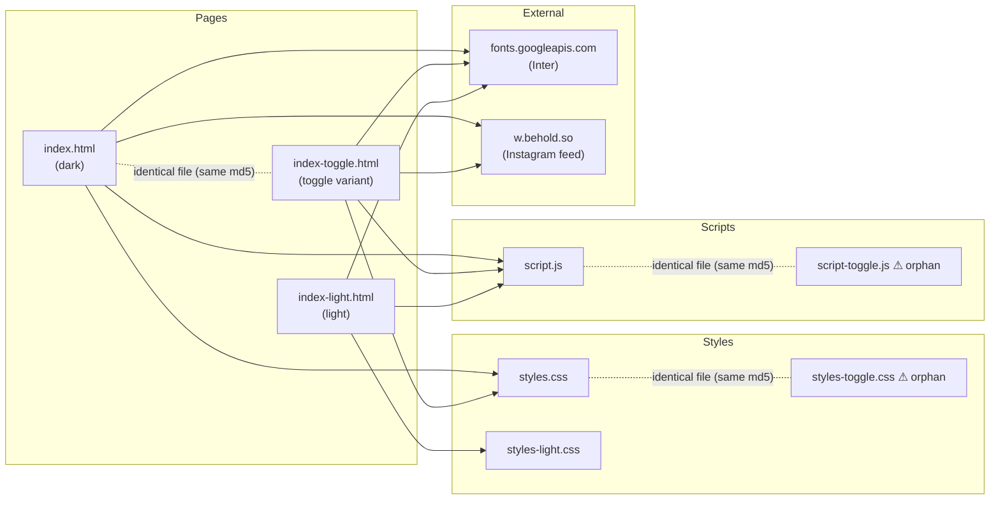

# Code Review Graph — Shaip Landing Page

Static dependency graph of the project files (HTML → CSS/JS/assets), generated for code review.

## Graph

## Edges

| Source | Target | Type | Notes |
|---|---|---|---|
| `index.html:17` | `styles.css` | local stylesheet | |
| `index.html:159` | `script.js` | local script | |
| `index.html:16` | fonts.googleapis.com | external | Inter webfont |
| `index.html:101` | `https://w.behold.so/widget.js` | external | Behold widget loader (inline script), replaces LightWidget |
| `index-light.html:16` | `styles-light.css` | local stylesheet | |
| `index-light.html:142` | `script.js` | local script | shares the dark-mode script |
| `index-light.html:15` | fonts.googleapis.com | external | |
| `index-toggle.html:17` | `styles.css` | local stylesheet | ⚠ points to `styles.css`, **not** `styles-toggle.css` |
| `index-toggle.html:159` | `script.js` | local script | ⚠ points to `script.js`, not `script-toggle.js` |
| `index-toggle.html:16` | fonts.googleapis.com | external | |
| `index-toggle.html:101` | `https://w.behold.so/widget.js` | external | Behold widget loader (inline script), replaces LightWidget |

## Orphan nodes (referenced by nothing)

| File | Finding |
|---|---|
| `styles-toggle.css` | Byte-identical duplicate of `styles.css`; no HTML links it |
| `script-toggle.js` | Byte-identical duplicate of `script.js`; no HTML loads it |
| `index-toggle.html` | Byte-identical duplicate of `index.html` (despite the "toggle" name) |
| `*.png` (16 logo/brand assets) | Never referenced; all images are inlined as base64 data URIs in the HTML |
| `*:Zone.Identifier` (13 files) | Windows download artifacts, not project files |

## Review findings summary

1. **Duplicated variants**: `index-toggle.html`, `styles-toggle.css`, `script-toggle.js` are exact copies of their non-toggle counterparts — the "toggle" variant currently adds nothing.
2. **Broken intent**: `index-toggle.html` links `styles.css`/`script.js`, so `styles-toggle.css`/`script-toggle.js` are dead code.
3. **Mixed content risk (fixed)**: LightWidget was loaded over `http://`; it has been replaced by the Behold widget (`https://w.behold.so/widget.js`).
4. **Dead assets**: all `.png` files are unreferenced (images are embedded as base64), inflating the repo; same for `:Zone.Identifier` artifacts.
5. **Shared script across themes**: `index-light.html` loads `script.js` (dark-theme script) — verify it doesn't assume dark-only DOM/behavior.
